# Subscription authentication visual evidence (#781)

Publication assets for the implementation pull request. The before views are rendered from the clean exact parent `1d5c97e3278d99b9d59fcdede1f4dcf6d242c992`. The after views use the final frozen frontend source identified in [the source hash manifest](verification/frontend-source-sha256.json). All 212 listed source file hashes were verified against the final implementation commit `6f0958acc2701d1a92ba438b9159bff582a788ee` before this evidence commit.

All application captures use controlled synthetic fixtures through the actual HTTP console, session and renderer under its production CSP, with an isolated live Valkey. They do not demonstrate a live provider login or live account quota. The parent captures import only the unchanged parent checkout. The final browser run passed 144 paints covering both themes, roles, read-only mode, keyboard and Copy interaction, no-JavaScript facts, quota exceptions and long identifiers.

The remote claude.ai artifact was inaccessible. Reference images show the repository's published-source ConnectionsScreen and ModelsScreen cards, served with their shared tokens and stylesheet. Their stylesheet rules, computed colors, card radius and native system font stack were checked after loading. `document.fonts.status` was `loaded`; no external web font is expected. Static reference Copy buttons are preview controls; the application Copy behavior was tested separately. The command-section comparison covers all three auth commands and the quota usage/trial variants, including labels, full argv and control hierarchy.

The source and application phone cards have matching dimensions and complete control sections. At desktop 1440 the Connections source card is906 px wide and the actual card917 px wide, both677 px high, because the existing page grids use different tracks. Fourteen of sixteen default card dimensions match exactly. No full-page pixel identity or direct remote comparison is claimed. Fixture dates may differ.

## Before and after

| View | Exact parent | Final implementation |
| --- | --- | --- |
| Connections, light desktop 1440 | 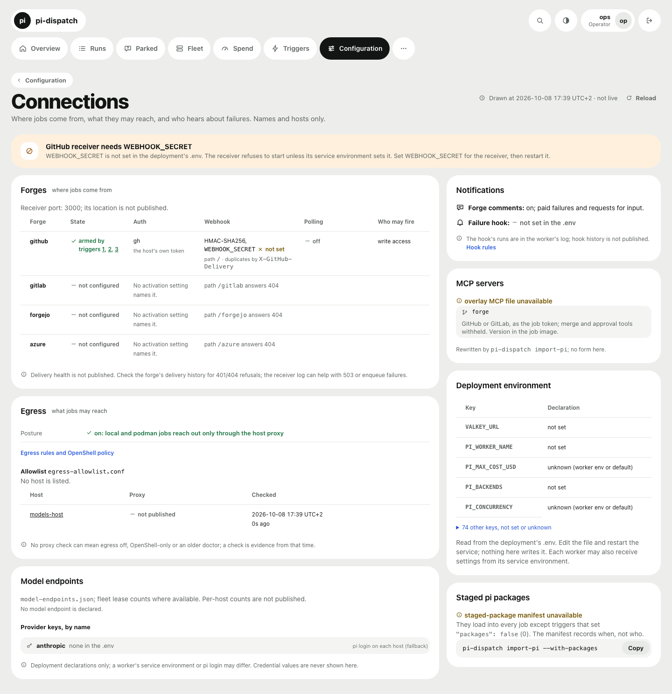 | 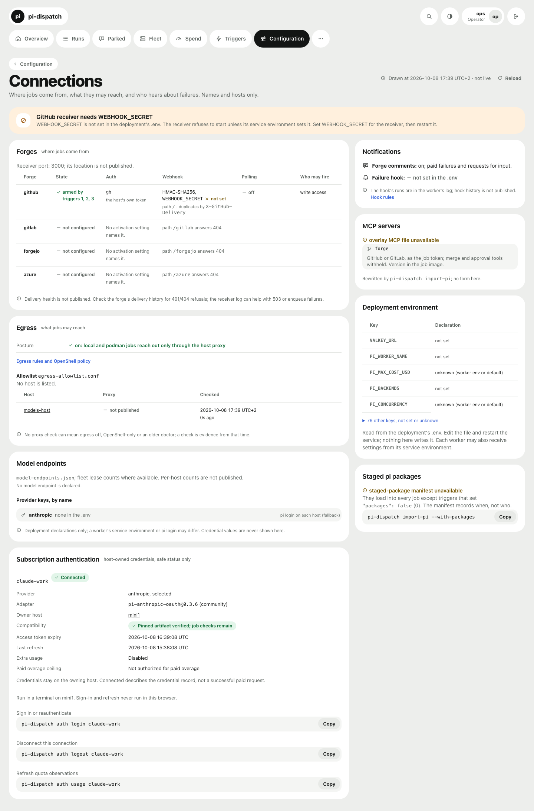 |
| Connections, dark phone390 | 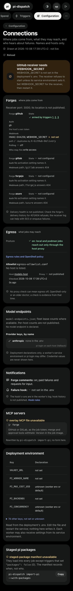 | 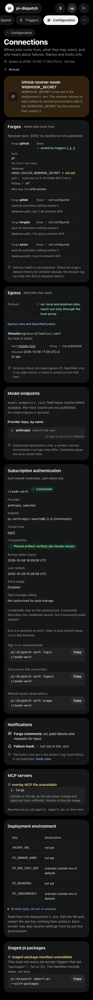 |
| Models, dark desktop 1440 | 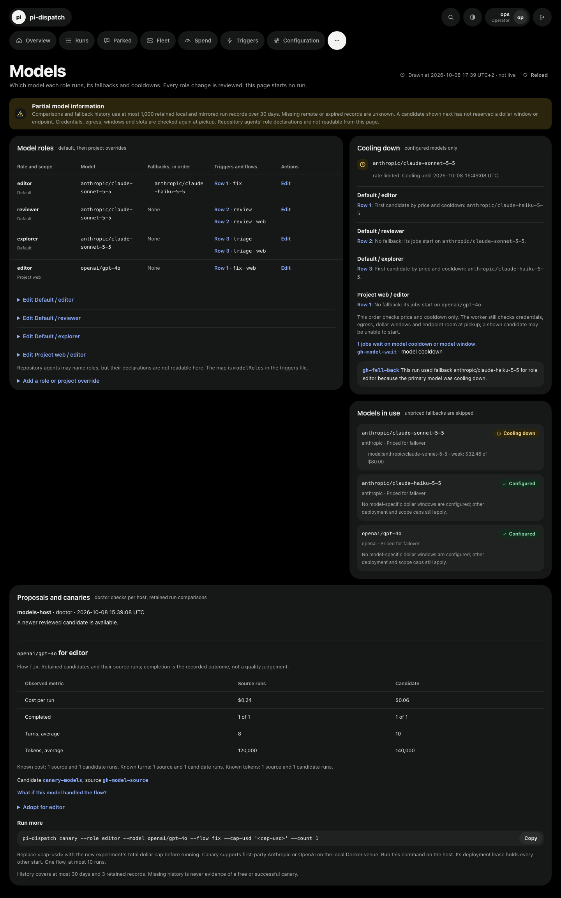 | 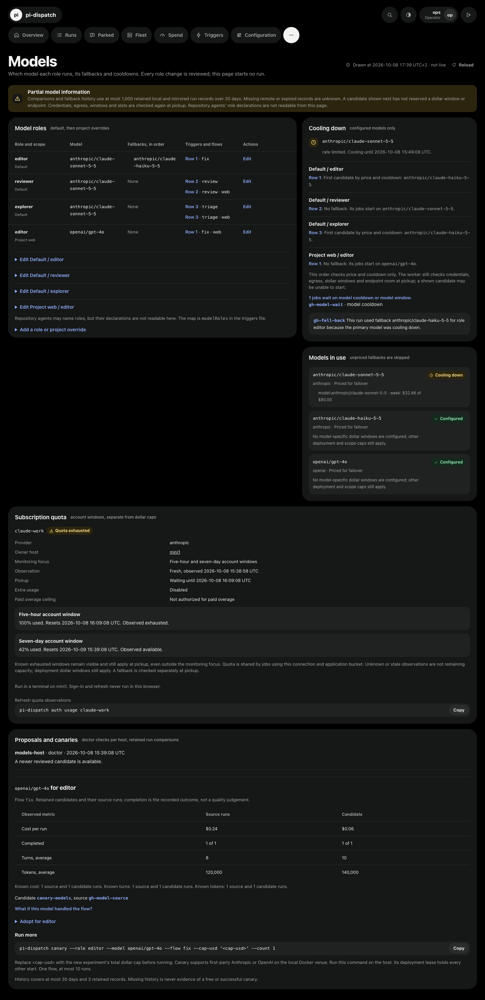 |
| Models, light phone390 | 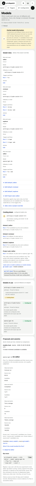 | 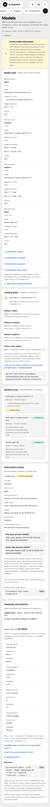 |

## Published-source comparisons

| Phone card | Styled published source | Actual application |
| --- | --- | --- |
| Authentication, light390 | 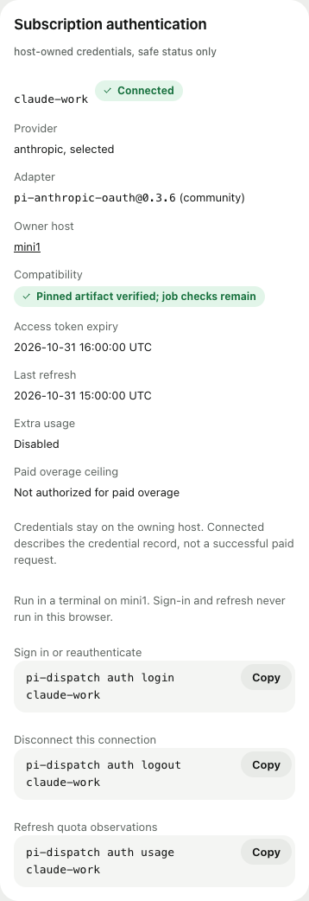 | 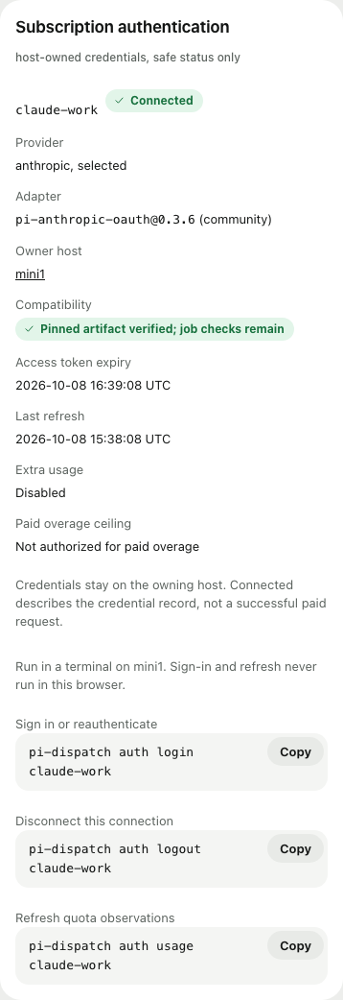 |
| Quota, dark390 | 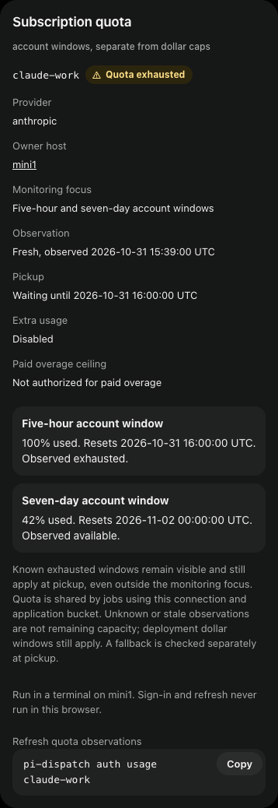 |  |

## Exceptional layouts and monitoring focus

| Counterexample | Actual application |
| --- | --- |
| Long host and connection identifiers, dark320 | 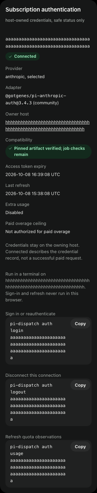 |
| Long quota identifiers, light375 | 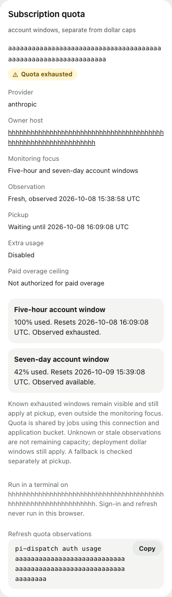 |
| Five-hour monitoring focus hides an available unselected weekly account window | 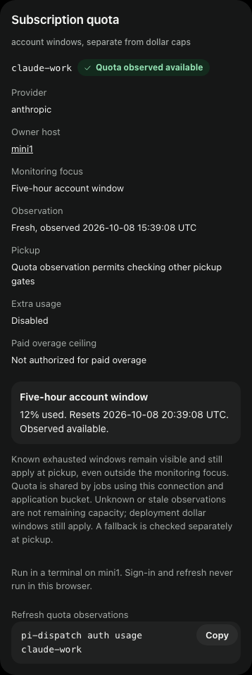 |
| An exhausted unselected weekly window stays visible and blocks pickup | 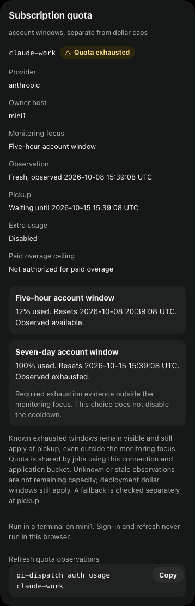 |

## Provenance and verification

- [Image manifest](manifest.json): SHA256, dimensions, viewport, role, theme and source category for all 16 PNGs.
- [Exact-parent provenance](verification/parent-provenance.json): unchanged source hashes and production-style/CSP checks.
- [Frozen frontend source hashes](verification/frontend-source-sha256.json), also in [sha256sum format](verification/frontend-source.sha256), verified against the final implementation commit.
- [Application style checks](verification/application-style-checks.json): loaded shared styles/fonts, field geometry and long-name line containment.
- [Reference style checks](verification/reference-style-checks.json): 24 styled default/conditional source-card captures.
- [Reference control comparisons](verification/reference-control-comparisons.json): 24 comparisons against production-rendered command structure.
- [Final card dimensions](verification/final-card-dimensions.json): dimensions read from the final reference/application PNGs.

This orphan evidence branch contains publication images and sanitized provenance only. It changes no application, credential, quota or admission contract. Root independently verified all16 published PNG hashes and dimensions, and all16 embedded images loaded and decoded in the actual [GitHub PR page](https://github.com/edgehero/pi-dispatch/pull/782). See [browser rendering evidence](verification/pr-image-rendering.json). The host-only canary follow-up changes none of the212 frozen frontend sources; every hash was independently rechecked against final commit `6f0958acc2701d1a92ba438b9159bff582a788ee`.
