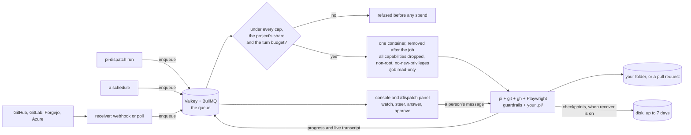

<p align="center">
  
</p>

# pi-dispatch

**Hand routine software work to an AI coding agent, and decide for yourself how closely you watch it.**

pi-dispatch runs the [pi](https://github.com/earendil-works/pi) coding agent for you in the background, on your own
computer or server. You say what it should work on and when. Each job happens in a sealed box that is thrown away
afterwards, stops at the spending limit you set, and shows up live on one web page. When the work is done you get a
proposed change to review. pi-dispatch never merges anything, so what ships stays a person's decision.

It is free and open source. You pay your AI provider for what the agent uses.

<picture>
  <source media="(prefers-color-scheme: dark)" srcset="docs/images/console/console-overview-dark.png?v=2026-11-03">
  
</picture>

<sub>The overview: what needs you, what is waiting, what is running and what today has cost. Every screen on this page shows sample data.</sub>

## Why: from in the loop to out of the loop

Working with a coding agent usually means sitting next to it. You type, it works, you check, you type again. That is
the right way to start, and it stops where one person's attention stops. pi-dispatch lets you step back at your own
pace, one kind of work at a time, and it never asks you to trust more than you have seen.

### 1. In the loop: watch it work and step in

You start a job and follow it live: what it is doing, which step of its plan it is on, what it said. If it heads the
wrong way you tell it, and it reads your message before its next step. You do not have to start over and pay for the
same work twice. ([Steering](docs/steering.md), [chat](docs/chat.md))


### 2. Near the loop: it comes to you when it needs you

Now it works alone, and you hear from it only when it has a question or needs permission. A job with a question stops
and waits. Nothing runs and no model is paid for while it waits, and your answer picks the work up where it stopped. A
gate can make it ask before a named action, and a rule you write can have an answer drafted for you to read and send.
([Parked questions](docs/sessions.md#parked-jobs-the-agent-asks-then-waits), [approval gates](docs/approval-gates.md),
[answer rules](docs/answer-rules.md))


### 3. Out of the loop: you review what comes back

Now the work starts without you: on a schedule, when someone labels an issue or comments on it, or (as a read only
investigation) when an alert comes in. You read the results when it suits you. **Zero touch** tells you how far you have
come: how often runs needed a person, per project, over the last 7, 30 or 90 days.
([Triggers](docs/triggers.md), [watching alerts](docs/watch.md), [Zero touch](docs/zero-touch.md))


Out of the loop does not mean out of control. The spending limits hold with nobody watching, every job stays in its
box, and a person still merges.

## Is this for you?

It fits when the same kind of software work keeps coming back and you would rather not sit through it:

- a nightly job that tidies a code base, updates a report or sorts new issues;
- "label an issue and a proposed fix appears", for small everyday fixes;
- answering review comments on the changes the agent proposed;
- several projects sharing one queue, one budget and one page.

For a one off task on your own machine, plain pi is enough.

## Common worries

**Do I need to be a developer?** To use it day to day, mostly not: the web page is where you read what happened, answer
questions, approve, add a schedule and change limits, and you describe a recurring job in plain sentences. To set it up
you need someone comfortable in a terminal, once. And what it hands you is code, so someone should be able to judge it
before it ships.

**Can it run up a bill?** You set limits in dollars and in jobs, per day, week and month, for everything or per project. A
job over a limit is refused before it starts, and a job with its own cap is stopped before any model call that could
take it past that cap. Also set a spending limit at your AI provider, as a last line
([costs](docs/costs.md), [limits](docs/scoped-limits.md)).

**Can it break my project?** On GitHub, GitLab, Forgejo or Azure DevOps a job works on a fresh copy and comes back with a
pull request for you to review, and on GitHub pi-dispatch refuses a repository whose default branch is not protected. A job
on a folder on your own machine edits that folder directly, with no undo, so it refuses a folder with uncommitted
changes unless you force it.

**Can it reach my passwords or my other files?** A job sees only its own project, inside its box, and can reach only the
internet addresses you allow. Two secrets do go in, and the agent can read them: your AI provider key and your GitHub or
GitLab token. That is why the provider limit above matters, and why a narrow token beats your whole login
([`SECURITY.md`](SECURITY.md) says plainly what is and is not defended).

**What if the machine restarts or a job dies?** The queue is kept on disk, so waiting jobs are still there. A job that
was running is lost or started over, unless its trigger opts into continuing from its last checkpoint
([durable runs](docs/durable-runs.md)).

**What does it cost?** pi-dispatch is free, under the MIT license. You pay your AI provider and for the machine it runs on.
The console shows what each project, job type, model and day cost, and whether a subscription would pay off
([insights](docs/insights.md)).

## What you see

**Spend:** today, this week and this month against your limits, and where the money went.


**Fleet:** every machine and what it is doing, with one switch that stops new work everywhere.


**A trigger:** what starts it, what it runs and what it has cost. A schedule also gets a button that fires it now.


**Your phone:** every page fits, for answering a question from wherever you are.


## How to use it

**1. What you need.** A computer or server that stays on: Linux, or a Mac or Windows machine with
[Docker Desktop](https://www.docker.com/products/docker-desktop/) while you are logged in. [Node.js](https://nodejs.org)
22.19 or newer. A key from an AI provider (Anthropic, OpenAI, Google, Groq and about thirty more). Someone comfortable
in a terminal, for this step and the next.

**2. Install it.** If you already use pi, type this and then `/dispatch` inside pi, which offers **Finish setup in
browser**:

```bash
pi install npm:@edgehero/pi-dispatch-admin
```

Without pi, install into a folder that will stay there:

```bash
mkdir my-dispatch && cd my-dispatch
npm install --save-exact @edgehero/pi-dispatch@4.3.1 @edgehero/pi-dispatch-admin@4.3.1 @earendil-works/pi-coding-agent@1.5.0 --omit=dev --omit=optional --ignore-scripts --no-audit --no-fund
./node_modules/.bin/pi-dispatch up --console
```

It asks before it starts anything, then prints a sign in link that works for 60 seconds.

**3. Finish the checklist in your browser.** The link opens `/setup`, a live list of what is ready and what is not:
the queue, a worker, the network rules, your provider key and a first trigger. It offers recipes for a first trigger:
fix an issue when it gets a label, tidy every night, or answer a comment.


<details>
<summary>Prefer the terminal? What <code>pi-dispatch doctor</code> checks</summary>


</details>

**4. Run a first job and watch it.** Start the worker from the checklist, give it a folder that is a git repository, and
open **Runs** in the console. You are in the loop.

```bash
./node_modules/.bin/pi-dispatch run ./my-project --task "add type hints" --flow tidy
```

A flow is a short text file of instructions in your project, such as `.pi/skills/tidy/SKILL.md`. The
[`examples/`](examples/) folder has one to copy.

**5. Give it a schedule or a label.** On **Triggers**, add a rule: every night at three, or whenever an issue gets the label
`pi:fix`. Turn on **steer** in the form, so you can talk to its jobs. To let a job stop and ask you, add `resume` and `awaitInput`
to the rule in `triggers.json`. You are near the loop.

**6. Step back when the numbers say you can.** Read **Zero touch** under Runs. When a kind of work rarely needs you, let
it run and review what comes back. You are out of the loop for that work, and still in charge of what ships.

To open the console again later, type `/dispatch console` in pi, or `pi-dispatch-console link --name <you>` for a new sign in link
([everything about the console](docs/console.md)).

## Words used here

| Word | What it means |
|---|---|
| **Agent** | A program that uses an AI model to read code, change it and run it |
| **pi** | The open source coding agent that does the work here. pi-dispatch runs it, and adds no agent of its own |
| **Job**, or **run** | One piece of work, from start to finish |
| **Trigger** | A rule for what starts a job: a schedule, a label, a comment |
| **Flow** | A short text file in your project with the standing instructions for a kind of job |
| **Container** | The sealed box a job runs in, thrown away afterwards |
| **Forge** | The place your code lives: GitHub, GitLab, Forgejo or Azure DevOps |
| **Console** | The web page shown here |
| **Panel** | The same information inside pi, as `/dispatch` |

## For engineers

Everything above in the terms you would run it by. pi has no job queue, no concurrency control, no spend limit and, by its
own README, no permission system. pi-dispatch adds exactly that layer and nothing else. It is not another agent to
compare with the one you use: it is the queue, the budget and the box around the pi you already run, steered by the
`.pi/` setup your repo already has.

> **Naming heads up.** The published packages are scoped: `@edgehero/pi-dispatch` (the `pi-dispatch` command). The bare npm
> name `pi-dispatch` belongs to an unrelated package (see [License](#license)), so outside a checkout always use the scoped
> name.

## Where it can run

pi-dispatch is a long running worker that starts containers, so it runs on a machine where it can do both: Node 22.19 or
newer beside a container runtime, on the same host.

| Where | Works? |
|---|---|
| A Linux server or VM you control (a VPS, a cloud VM, a home server) | **Yes.** The main target. Run the worker as a service ([Run as a service](#run-as-a-service)). |
| Your own Mac or Windows machine with Docker Desktop | **Yes**, while you are logged in, because Docker Desktop is. |
| Several machines sharing one queue | **Yes** ([`docs/multi-host.md`](docs/multi-host.md)). |
| Serverless and app platforms (Vercel functions, Netlify, Cloudflare Workers, a PaaS without a container runtime) | **No.** There is no container runtime to start jobs in, and nowhere for a worker that never stops. |
| Hosted sandbox services as the place jobs run (Vercel Sandbox, E2B, Modal, Daytona and similar) | **Not yet.** A new venue needs an adapter, and [`docs/backends.md`](docs/backends.md) is the contract it would implement. |
| A Docker or Podman daemon on another machine (`DOCKER_HOST=ssh://...`) | **No.** Job files are mounted from the worker's own disk, which that machine does not have, and it would receive every job's provider key and forge token. |

Only the receiver needs to be reachable from the internet, and only for webhooks. Behind a firewall, use the receiver's
`poll` mode instead, which needs no public URL ([`docs/polling.md`](docs/polling.md)).

- **`local`**, the default: the Docker daemon, or rootful Podman through its Docker API. Easiest to set up, and the only
  choice on macOS and Windows. The worker needs the daemon's socket, and that access is equivalent to root on the host.
- **`podman`**: rootless Podman as the worker's own account, on Linux. No daemon runs as root, each job runs as the
  worker's own uid, and Valkey, the egress proxy and the worker run as systemd user units. Pick it for a shared or security
  sensitive server ([`docs/podman.md`](docs/podman.md)).
- **`openshell`**: one NVIDIA OpenShell sandbox per job on a gateway on this host, in copy mode, so nothing of the job is
  mounted into the sandbox. The gateway's policy is the egress control, so no egress proxy starts. A provider made for each job
  holds its secrets, one per endpoint, so the agent sees placeholders rather than the values, with no secrets manager
  needed. `openshell-bind` runs the same policy with the job's folders bind mounted. `pi-dispatch doctor --openshell` checks the gateway first, and both
  [`up`](docs/backends.md#the-openshell-venue) and `service install` set it up. Pinned to OpenShell 0.1.4, since its
  interfaces are marked experimental.

Each job gets the memory and CPUs its project's row sets (4 GB and 2 CPUs by default), and starts only when its size fits
beside what already runs on that machine ([`docs/sizing.md`](docs/sizing.md)).

## Providers and models

**pi-dispatch itself needs no AI key.** The queue, the caps, the containers, the console and the panel run no model. The key
is for pi, inside each job. pi-dispatch works with most providers pi supports. Pick the default in `.env`:

```bash
PI_PROVIDER=anthropic
# an exact model version keeps cost predictable
PI_MODEL=claude-sonnet-5-5
ANTHROPIC_API_KEY=...
```

Override them for one job with `--provider` and `--model`. The worker asks pi which variable your provider reads, and
`doctor` checks that it is set. If you are logged into pi with an API key, leave it blank: the worker reads it from
`~/.pi/agent/auth.json`. A subscription login is opt in, through an explicit connection whose renewal stays on the host
([`docs/subscription-auth.md`](docs/subscription-auth.md)). Providers without a single key variable (an AWS profile for
Bedrock, for example) are refused before anything is spent. Roles, fallbacks and canary comparisons are on the console's
Models page ([`docs/model-roles.md`](docs/model-roles.md), [`docs/model-failover.md`](docs/model-failover.md)). A trigger's
`run.models`, or `PI_ALLOWED_MODELS`, names the models a job may call, and the job is stopped before it calls another.

## Triggers

**A trigger is what starts a job.** All standing triggers live in one `triggers.json`, which the worker and the receiver read
live, and which the console and the panel can edit. Each entry is an `{ on, run }` pair: **`on` says what fires it**, and
**`run` says what it runs**.

```jsonc
{ "triggers": [
  { "on": { "type": "cron", "id": "nightly", "pattern": "0 3 * * *" },
    "run": { "kind": "local", "folder": "/srv/site", "flow": "tidy", "task": "run the nightly tidy" } },
  { "on": { "type": "label", "any": ["pi:frontend"] },              "run": { "kind": "github", "flow": "frontend-fix" } },
  { "on": { "type": "comment", "phrase": "@pi" },                   "run": { "kind": "github", "flow": "fix" } },
  { "on": { "type": "pull_request", "action": ["labeled"], "any": ["pi:review"] }, "run": { "kind": "github", "flow": "review" } },
  { "on": { "type": "label", "any": ["pi:fix"] },                   "run": { "kind": "gitlab", "flow": "fix" } }
] }
```

| `on.type` | Fires when | The agent's task |
|---|---|---|
| `cron` | your schedule | `run.task` from the file |
| `label` | a label is added to an issue (or an Azure work item) | the issue title and body |
| `comment` | a comment contains your phrase, such as `@pi` | the comment plus the issue |
| `pull_request` | a PR or MR event, a submitted GitHub review, or a close | the PR title and body |
| `issue` | an issue closes | the issue title and body |

`run` names a `flow` or a registered pi `command`. **Who may fire a trigger is decided by your forge, not by pi-dispatch**:
[`SECURITY.md`](SECURITY.md) states each forge's rule. Each optional `run` field, in a line:

- `steer`: a running job takes messages ([steering](docs/steering.md)).
- `resume`, `awaitInput`: follow up jobs continue the session, and the agent can ask and wait ([sessions](docs/sessions.md)).
- `recover`: a lost run continues from its last checkpoint ([durable runs](docs/durable-runs.md)).
- `progress`, `statusComment`: the agent names its phase, and one comment on the issue keeps the numbers ([triggers](docs/triggers.md#optional-run-fields)).
- `image`: this trigger's own job image ([job image](docs/job-image.md)).
- `secrets`, `secretsProfile`, `secretBundle`: vault references, and a project's one shared environment ([secrets](docs/secrets.md#recipe-d-one-environment-for-a-whole-project)).
- `mcp`, `forge`: MCP servers for its jobs ([MCP](docs/mcp.md)).
- `excludeTools`: removes named built in tools ([excluded tools](docs/exclude-tools.md)).
- `packages`: opts out of the staged pi packages ([workflows](docs/workflows.md)).
- `models`, `maxCostUsd`: the models a job may call, and its own dollar cap ([triggers](docs/triggers.md#optional-run-fields)).
- `replicas`: races independent sandboxes on one event ([replicas](docs/replicas.md)).
- `waitFor`: holds a job, unstarted and unbilled, until a time or your own check ([waiting](docs/wait-for.md)).
- `instructions`, `skillsDir`, `github`, `portfolio`: the rest are in [`docs/triggers.md`](docs/triggers.md#optional-run-fields).

A whole project can get one environment from your secrets manager, granted once and read fresh at each job start. Quiet
hours pause a repo or folder by weekday and timezone ([`docs/pause-windows.md`](docs/pause-windows.md)). The
portfolio manager example plans a budget split for the week and reports what it asked for
([`docs/portfolio-manager.md`](docs/portfolio-manager.md)).

## Flows: the custom prompt a trigger runs

A **flow** is a pi skill, a Markdown instruction file, committed to the target repo at `.pi/skills/<flow>/SKILL.md`. That file
is the prompt. A trigger only names the flow, so each repo can define the same flow name its own way.

```markdown
<!-- .pi/skills/tidy/SKILL.md -->
---
name: tidy
description: Format, fix lint, and tighten types across the repo.
ai-trigger: allow        # opt-in for AI-INITIATED runs only (the dispatch_run tool, job chaining). Default deny.
---

Run the formatter and linter and fix what they report; tighten obvious type holes.
Keep the diff minimal and open a PR titled "tidy: <what changed>". Do not change behavior.
```

The flow holds the standing instructions. The **task** is the one off request: your `--task`, a trigger's `task`, or the issue
or comment text. Flows are read from the **default branch**, so a flow must be merged before a trigger can use it. That merge
is the repo's consent. `ai-trigger` only decides which flows a model may start. It does not decide who may fire a job: a cron
or forge trigger in your reviewed `triggers.json` runs its flow either way
([flows in detail](docs/triggers.md#flows-in-detail), [multi stage workflows](docs/workflows.md)).

## What runs, and what protects you



Every trigger takes this path: spend is checked before the container starts, and nothing is dropped. Read
[`SECURITY.md`](SECURITY.md) before you rely on it.

- **Network egress is denied by default.** Each job gets its own network behind an allowlist proxy, and a job the policy cannot
  serve is refused before it spends. The allowed hosts are yours to list ([`docs/egress.md`](docs/egress.md)).
- **Token and cost records cover the whole job**, including subagent sessions and `pi` child processes, and the per job token
  budget is enforced against that same total ([`docs/costs.md`](docs/costs.md#pi-child-processes)).
- **The container runtime is a named backend** that declares what it guarantees. `pi-dispatch doctor` prints the declaration, and
  `pi-dispatch doctor --live` reads eight of those properties back from real containers ([`docs/backends.md`](docs/backends.md)).
- **Credentials.** On Docker and Podman the provider key and the forge token go in as environment values, and **the agent can read both**. The
  guardrails tell it never to print or send them, but that is prompt text, not enforcement. Bound the key with a **spend limit at
  your provider**. On GitHub the token is one hour for one repo with the App, or **your whole login, full scope and never
  expiring**, with the default `gh` source. Anything in `PI_FORWARD_ENV` has the same exposure. The limit is on the damage, not
  on the leak. None of these have to sit in a file ([`docs/secrets.md`](docs/secrets.md)).

## Costs, projects and capacity

**Costs.** A turn limit per job, job and token caps for the whole deployment, dollar caps per day, week and month, and a dollar
cap per job. Caps can apply per repo, folder, model or project. Every job writes a durable record with ids only, never issue or
comment text, with a usage ledger per model that the insights page prices ([`docs/costs.md`](docs/costs.md),
[`docs/insights.md`](docs/insights.md)). A zero rate run with no declared plan reads `$0 (unrated)`, never "free".

**Projects and split.** Group repos and folders into projects and cap each as one. Set a dollar total with a floor per project, and a
flow can move money between projects inside it, never above the total or below a floor. Every move is logged and can be reverted
([`docs/projects.md`](docs/projects.md), [`docs/allocation.md`](docs/allocation.md)).


**Capacity.** Each machine keeps its own memory and CPU budget, and room is kept for a waiting big job so small ones cannot starve it.
The console, `pi-dispatch capacity` and `doctor` report how busy each host was. They count jobs only: a machine busy with other work
reads as idle ([`docs/sizing.md`](docs/sizing.md), [`docs/insights.md`](docs/insights.md)).


**Flows map.** Which triggers start which flows, what chained to what, and what each cost ([`docs/graph.md`](docs/graph.md)).


The console also has [Models](docs/console.md#the-screens), [Watch](docs/watch.md), an [audit log](docs/console.md#the-audit-log)
of every write, and Configuration. Each write is a preview and a confirm, and paid and destructive ones look different.


## Reuse your existing pi setup

Give every job your host pi setup, layered under each repo's own `.pi/`. The repo wins on any conflict:

```bash
pi-dispatch import-pi   # stage a credential-free copy of ~/.pi/agent into ./pi-global
                        # then set PI_GLOBAL_PI_DIR in .env; doctor checks it holds no credential
```

Credentials never enter this copy, third party packages are pinned once at the version your host has, and what a repo declares is
never installed ([`docs/global-pi-overlay.md`](docs/global-pi-overlay.md)). A repo's own `.pi/extensions` do run, because the
checkout is the default branch and merging is the gate. MCP servers are yours, not the repo's ([`docs/mcp.md`](docs/mcp.md)).
Sessions save the full transcript to disk, which is a real disclosure: read [`docs/sessions.md`](docs/sessions.md) before you turn
them on.

## Run as a service

```bash
pi-dispatch service render    # show the unit it would install, with the real paths
pi-dispatch service install   # LaunchAgent (macOS), systemctl --user (Linux), nssm (Windows, a machine service)
pi-dispatch service status    # which unit exists, where, and whether it runs
pi-dispatch service restart --drain   # pause, wait for running jobs, restart, resume
```

`install` renders the [`deploy/`](deploy/) templates without sudo (`--system` on Linux prints the sudo commands instead, for a manual
`sudo cp`). `--receiver` and `--console` install those units instead, and `--env-setup <path>` wraps the worker in your secrets
manager's setup script. Run one worker per container daemon. The details, and the limits on macOS and Windows, are in
[`docs/service.md`](docs/service.md).

### Control the worker

From any terminal: `pi-dispatch pause` stops taking new jobs and survives restarts, `resume` takes them again, `status` prints counts,
`cancel <jobId>` stops one job in any state, `run --trigger <id>` runs one cron trigger now, and `capacity` says how busy each host was.
These read only what they need, so a broken forge setting cannot stand between you and the stop
([`docs/service.md`](docs/service.md#control-the-worker)).

## The pi panel

`/dispatch` is the same information inside your own pi session, as a **pi extension**: no daemon, no network port. Install it with
`pi install npm:@edgehero/pi-dispatch-admin`. It writes a small pointer file, paths only and never credentials, so the panel finds
your deployment from any directory.


Its keys, its plain commands and the `operate-pi-dispatch` skill, which lets you ask your assistant in plain words with every change
confirmed by you in a prompt the model cannot answer, are in [`docs/panel.md`](docs/panel.md).

## GitHub automation

Label an issue, and a container works on a fresh clone, opens a PR and comments back.

- **Only a collaborator's label, `@pi` comment or formal review starts a job.** A PR from a stranger's fork never starts a job on its
  own. A review is gated on the **reviewer**, so a collaborator reviewing that fork PR does start one.
- **The token can merge.** GitHub puts push and merge behind the same permission, so under every auth source the job's token could
  merge. pi-dispatch never does, and **branch protection on your default branch is the real control**. The worker refuses a repo
  without it, before any spend.
- **Which token a job holds depends on the auth source.** The GitHub App mints one per job, for one repo, valid for an hour. The default
  `gh` source forwards **your own login, full scope and never expiring**, and `pi-dispatch doctor` warns about that.
- **The checkout is always the base repo at its default branch**, never a PR branch. A commit that lands on your default branch can run
  code in a job. Issue and comment text never can; it stays data.

`pi-dispatch setup github` creates a GitHub App in one browser click, shows every `.env` line before you agree, and never prints a secret.
Run the part that takes in forge events as a webhook receiver on the host or in a container, or in `poll` mode with no public URL
([`docs/github.md`](docs/github.md), [`docs/polling.md`](docs/polling.md)).

## Other forges

| Forge | Webhook | Who may fire a job | Doc |
|---|---|---|---|
| GitLab, 17.4 or newer, self hosted through `GITLAB_URL` | `/gitlab` | Developer or higher, checked on every trigger | [`docs/gitlab.md`](docs/gitlab.md) |
| Forgejo and Gitea | `/forgejo` | Permission on that repository, read with a separate token no job sees | [`docs/forgejo.md`](docs/forgejo.md) |
| Azure DevOps | `/azure`, a Service Hook | The weakest transport of the four (no HMAC signature, no signed timestamp), so read the doc first | [`docs/azure-devops.md`](docs/azure-devops.md) |

These forges have one auth source each, a token you create, so setting theirs to `app` gets a clear refusal at boot.

## Docs

**Getting started and running it:** [console](docs/console.md), [panel](docs/panel.md), [service](docs/service.md),
[backup](docs/backup.md), [multi host](docs/multi-host.md), [polling](docs/polling.md), [notifications](docs/notifications.md).

**Watching and steering:** [steering](docs/steering.md), [chat](docs/chat.md), [sessions](docs/sessions.md),
[durable runs](docs/durable-runs.md), [approval gates](docs/approval-gates.md), [answer rules](docs/answer-rules.md),
[Zero touch](docs/zero-touch.md), [watch](docs/watch.md), [watch decisions](docs/watch-decisions.md),
[reasons](docs/reasons.md).

**Triggers and flows:** [triggers](docs/triggers.md), [workflows](docs/workflows.md), [wait for](docs/wait-for.md),
[pause windows](docs/pause-windows.md), [replicas](docs/replicas.md), [canary](docs/canary.md),
[excluded tools](docs/exclude-tools.md), [MCP](docs/mcp.md), [global pi overlay](docs/global-pi-overlay.md).

**Money and machines:** [costs](docs/costs.md), [insights](docs/insights.md), [graph](docs/graph.md),
[scoped limits](docs/scoped-limits.md), [projects](docs/projects.md), [allocation](docs/allocation.md),
[portfolio manager](docs/portfolio-manager.md), [sizing](docs/sizing.md).

**Models and keys:** [provider keys](docs/provider-keys.md), [subscription auth](docs/subscription-auth.md),
[model roles](docs/model-roles.md), [model failover](docs/model-failover.md), [model proposals](docs/model-proposals.md),
[secrets](docs/secrets.md).

**Isolation:** [backends](docs/backends.md), [Podman](docs/podman.md), [egress](docs/egress.md),
[job image](docs/job-image.md), [sandbox](docs/sandbox.md), [sandbox gateway](docs/sandbox-gateway.md).

**Forges:** [GitHub](docs/github.md), [GitLab](docs/gitlab.md), [Forgejo](docs/forgejo.md),
[Azure DevOps](docs/azure-devops.md).

## How it compares

**vs the Claude Code GitHub Action**: for GitHub only automation the
[action](https://github.com/anthropics/claude-code-action) handles label triggered issues with a tenth of the setup. pi-dispatch is for
running pi on your own hardware with a real queue, a container boundary, and flows against **local folders** as well as repos.

**vs hosted routines and `/loop`**: for "run a prompt on a schedule" they are simpler, with nothing to host. pi-dispatch's cron trigger is
for recurring work that needs a project's exact toolchain, or the built in Playwright and Chromium that let a flow build a frontend and
check how it renders.

## Status

Everything on this page is built and running, on all four forges and on Docker and Podman.

The design lives in [`specs/`](specs/), and the specs are the source of truth, not a summary of the code. Start with
[`specs/constitution.md`](specs/constitution.md) for the rules that never bend, [`specs/design.md`](specs/design.md) for the decisions and
what was rejected, and [`specs/interfaces.md`](specs/interfaces.md) for the file and container contracts. Every spec file ends with a
revision history, corrections included.

## Contributing

PRs welcome. Sign off your commits with `git commit -s`: this project uses the [DCO](https://developercertificate.org/), not a CLA. If you
change how the code behaves, the spec changes with it. A PR that breaks a `CONST-*` entry will be asked to justify changing the rule first,
not the code. [`AGENTS.md`](AGENTS.md) is the short version of what matters here.

## License

MIT. See [LICENSE](LICENSE). Built on [pi](https://github.com/earendil-works/pi) by Mario Zechner, which does the actual hard part.

> **Not affiliated with** the unrelated npm package `pi-dispatch`, a pi extension for rotating ChatGPT Codex OAuth accounts. Same name,
> different thing. This project publishes scoped packages only:
> [`@edgehero/pi-dispatch`](https://www.npmjs.com/package/@edgehero/pi-dispatch) (worker and CLI),
> [`@edgehero/pi-dispatch-receiver`](https://www.npmjs.com/package/@edgehero/pi-dispatch-receiver), and
> [`@edgehero/pi-dispatch-admin`](https://www.npmjs.com/package/@edgehero/pi-dispatch-admin) (the console and the panel). The bare name is theirs.
