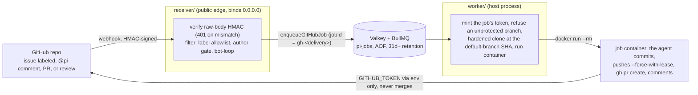

# GitHub automation

This page is the detail behind the [GitHub automation](../README.md#github-automation) section of the README.

Label an issue, and a container works it on a fresh clone, opens a PR, and comments back:

## Who can start a job, and what the token can do

- Only a collaborator's label, `@pi` comment or formal review starts a job. The label is the approval
  step. PR triggers (label, comment, auto on open/update, or a submitted review) gate the auto path on
  the PR author being a collaborator. A fork PR from a stranger never auto-fires. A review trigger gates
  on the **reviewer** instead. This way a collaborator reviewing that same fork PR can fire it.
- What bounds the per-job token depends on which auth source you run. The App creates one scoped to a
  single repository. It expires in an hour. The default `gh` source forwards your own login into every
  token-carrying job. It has full scope and does not expire. This is what `pi-dispatch doctor` warns
  about. Under every source it *can* merge, because GitHub gates push and merge behind the same scope.
  **Branch protection on your default branch is the real control.** The worker refuses an unprotected
  repo before any spend. A branch protection rule and a ruleset both count
  ([which branches count as protected](#which-branches-count-as-protected)).
- The checkout is always the base repo at its default-branch SHA. It is never a PR branch. Landing a
  commit on your default branch is enough to run code in a job container. Issue and comment text never
  runs code. It stays data.

## Credentials in one click

`pi-dispatch setup github` runs GitHub's App Manifest flow against your own
loopback. One browser click creates the App id, private key and webhook secret. Every `.env` line is shown
before one consent. The key lands with mode 0600. No secret is ever printed. The App is the strongest
auth source (per-repo one-hour tokens). A fine-grained PAT carries an expiry you set. `gh` carries
neither (`GITHUB_AUTH_SOURCE`).

## App permissions

The App that `pi-dispatch setup github` makes asks for these repository permissions, named as GitHub's settings page
names them:

| Permission | Access | What needs it |
|---|---|---|
| Contents | Read and write | the agent pushes its branch, and before each job the worker reads whether the default branch is protected |
| Pull requests | Read and write | the agent opens its pull request |
| Issues | Read and write | the worker's status comments and the agent's replies |
| Metadata | Read-only | GitHub gives it to every App |

When the worker starts under `GITHUB_AUTH_SOURCE=app`, it reads what the App's installation was granted and logs a
`github_app_permission_missing` line naming any of these it lacks. To add one, set it in the App's settings on GitHub
(Developer settings, GitHub Apps, then the App, then Permissions & events), save, and accept the new permission on
the App's installation. Until the installation accepts it, its tokens do not carry it.

### Which branches count as protected

The worker reads protection from the default branch itself, which GitHub marks protected when a branch protection rule
or a ruleset covers it: the repository's own ruleset, or one its organization or enterprise applies. Either kind
counts. The worker checks only that the branch is protected, not what the rule requires, so make it require a pull
request review. A ruleset that is disabled, or only evaluated, enforces nothing.

### A token that cannot read the branch

GitHub refuses the worker's read of the default branch to a fine-grained PAT without access to the repository's
contents, and to a classic token or `gh` login not yet authorized for an organization that uses single sign-on. The
worker then refuses each job as [`branch-protection-unreadable`](reasons.md#branch-protection-unreadable), before
anything is spent.

## Three ways to run the trigger edge

Pick one, or let `/dispatch setup` walk you through the choice, which it offers right after the
credentials step:

1. **Webhook receiver on the host** (lowest latency): Run `npx @edgehero/pi-dispatch-receiver` from your
   deployment
   folder. Or run `pi-dispatch service install --receiver` to run it as a user-level service. Your reverse
   proxy or tunnel does the public exposure.
2. **Webhook receiver in a container**: Run `docker compose --env-file .env -f deploy/docker-compose.yml
   --profile receiver up -d`. This runs the prebuilt
   [`ghcr.io/edgehero/pi-dispatch-receiver`](https://github.com/edgehero/pi-dispatch/pkgs/container/pi-dispatch-receiver)
   beside Valkey. It needs `deploy/docker-compose.yml`, which a clone carries and `/dispatch setup` copies in
   when you choose the receiver container. Triggers are mounted read-only. No docker socket goes
   anywhere. In a folder `/dispatch
   setup` built, the
   compose file sits in `deploy/` of that folder. The command names the folder's own project with `-p <folder
   name>` (lower case, only letters, digits, `_` and `-`). Where `pi-dispatch up` had already started the
   deployment's Valkey, add `-f deploy/docker-compose.valkey.yml`. This gives compose's Valkey that same
   volume, so the worker and the receiver share one queue. Run it the same way afterwards. Setup hands
   over only a
   `pi-dispatch-valkey` that is this folder's. It refuses while another deployment's Valkey uses that volume.
3. **No public URL at all**: Run `pi-dispatch-receiver poll` to fetch issue events, comments and PRs over TLS
   with your own credential. It uses conditional requests, nearly free against the rate limit. Same
   gates, same
   queue, about 60 seconds of latency, zero public surface. Pair with `setup github --no-webhook`. A
   fresh poller starts from now and never replays old labels. Name the repositories in `POLL_REPOS`. Or
   run under `GITHUB_AUTH_SOURCE=app` and let the App installation name them
   ([`docs/polling.md`](polling.md)).

## When a delivery fails

GitHub sends each delivery once. It does not send it again on its own, whatever the receiver answered, and it marks a
delivery failed when the answer is not a 2xx or takes longer than 10 seconds. The receiver answers **503** when it
cannot finish a delivery, in two cases:

- **The enqueue failed**, for example while Valkey is down. The receiver logs `enqueue_failed` with the delivery id.
  On a trigger with `replicas`, the line also says how many replicas were queued before the failure (`queued` of
  `replicas`). Those stay queued and run; the rest were never queued.
- **The permission lookup for a close failed** (close triggers only, see [triggers.md](triggers.md)). The receiver
  logs `github_permission_lookup_failed` with the delivery id. Nothing was queued.

Either way the delivery does not run unless someone redelivers it, and GitHub keeps deliveries for that for 3 days.

**Redelivering one.** Open the webhook's **Recent Deliveries**: for the App that `pi-dispatch setup github` made, the
App's settings, **Advanced**; for a repository or organization webhook, its **Webhooks** settings. Pick the delivery
whose id the log line names and choose **Redeliver**. With the REST API, list the deliveries
(`GET /app/hook/deliveries` for the App, `GET /repos/{owner}/{repo}/hooks/{hook_id}/deliveries` for a repository
webhook), find the entry whose `guid` is the logged id, and `POST` to that entry's `/attempts`
(`/app/hook/deliveries/{delivery_id}/attempts`).

A redelivery carries the same `X-GitHub-Delivery` id, so it is queued at most once: a delivery that did queue (one
GitHub marked failed only because the answer was slow, say) is not queued again, since its job id is already in the
queue, and on a replica trigger the replicas already queued stay one job each while the rest queue.

**Where you see failures.** The two log lines, and the console's Connections page, which counts `lookup-failed` and
`enqueue-failed` per forge over the last 24 UTC hours and warns when either is above zero. It counts answers, so a
redelivery that succeeds later does not lower it.

**A close has one backstop.** The polling transport (`pi-dispatch-receiver poll`, [polling.md](polling.md)) reads
closes from the events feed with its own ids and retries a failed lookup itself for a while, so it catches a close
the webhook answered 503 for, on a repository it polls. On any other repository a close answered 503 needs a redelivery.
